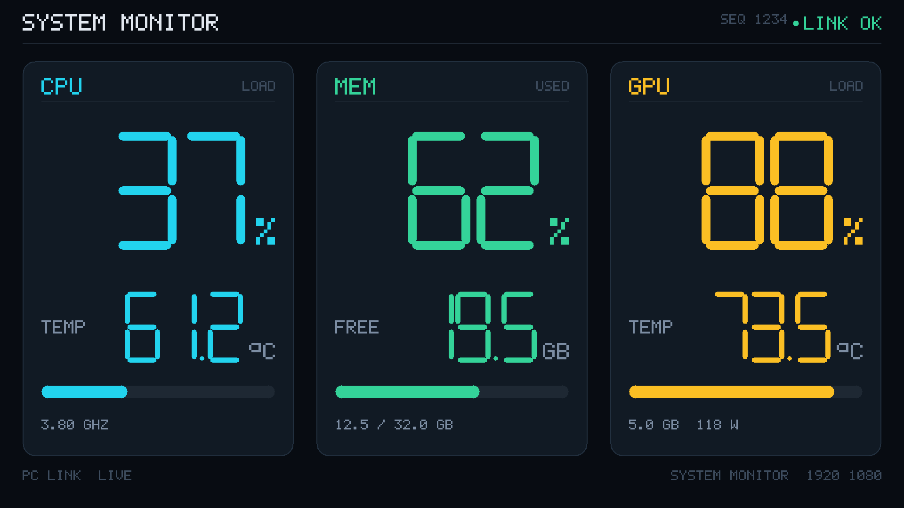

# 笔记本状态监控屏 · 1920×1080

一个全屏看板，显示 **CPU / 内存 / GPU 的占用率和温度**。窗口拖到小屏幕上按 `F` 全屏就行。



## 快速开始

**第 1 步：装 LibreHardwareMonitor**（CPU 温度只在它有，Windows 本身不提供）

1. 从 [releases](https://github.com/LibreHardwareMonitor/LibreHardwareMonitor/releases) 下 `LibreHardwareMonitor.zip`
2. 解压到 `C:\Tools\LibreHardwareMonitor`（或别的地方，然后设环境变量 `LHM_EXE` 指向它的 exe）
3. 打开 `LibreHardwareMonitor.config`（跟 exe 同目录），确保有这两行 —— 这样它启动就自带 web server，
   省得每次手点菜单：

   ```xml
   <add key="runWebServerMenuItem" value="true" />
   <add key="listenerPort" value="8085" />
   ```

   文件不存在就先双击一次 LHM 让它生成，再用记事本补上。

> 不装也能跑：CPU 温度会显示 `-- °C`，其它指标都正常。

**第 2 步：生成快捷方式（只做一次）**

双击 **`dashboard\setup.bat`** —— 它会找到本机的 Python，并生成三个免黑框的快捷方式。

**第 3 步：日常使用**

双击 **`dashboard\监控屏.lnk`** —— 不弹黑窗口，一整套全起来：

1. CPU 温度服务：拉起守护进程 `lhm_supervisor.py`（管理员权限，弹一次 UAC）→ 它隐藏启动
   LibreHardwareMonitor 并接管，**LHM 的窗口不会出现**，任务栏托盘也没有
2. 数据服务后台常驻，日志在 `dashboard\server.log`
3. 浏览器窗口打开，等第一帧数据就绪才显示，不会先闪 NO SIGNAL

- 停止：双击 `dashboard\停止监控屏.lnk` —— 画面服务和温度服务**一起关**（不用再点 UAC）
- 出问题排错：看 `dashboard\launch.log`、`dashboard\lhm_supervisor.log`，或双击 `start.bat`

然后：**拖到小屏幕 → `F` 或 `F11` 全屏 → `Esc` 退出**。
鼠标 3 秒不动光标自动隐藏。

不需要装任何 Python 库：有 `psutil` 就用，没有就 ctypes 直接调 Win32 API
（`GetSystemTimes` / `GlobalMemoryStatusEx`），GPU 走 `nvidia-smi`。

> 只想看 UI 不采数据：`python dashboard/server.py --demo`

## 屏幕上有什么

| 卡片 | 大字 | 副数值 | 底部小字 |
|---|---|---|---|
| CPU（青） | 总占用率 % | `TEMP` 温度 °C | 当前频率 GHz |
| MEM（绿） | 内存占用率 % | `FREE` 剩余 GB | 已用 / 总量 GB |
| GPU（橙） | GPU 占用率 % | `TEMP` 温度 °C | 显存 GB + 功耗 W |

- 占用率 ≥ 70% 变黄、≥ 90% 变红，进度条同步变色
- 右上角 `LINK OK`（绿）/ `NO SIGNAL`（红），服务断了会自己变红，不会白屏
- 数据 2Hz 刷新，只重绘变化部分

## 分辨率

画布固定 **1920×1080**（设计基准），CSS 等比铺满窗口：

- 小屏就是 1920×1080 → 1:1 像素对应
- 2560×1440 / 1024×600 → 整体等比缩放，版式不变
- 宽高比差太多会留黑边（不拉伸变形）

单独预览某个尺寸：`http://127.0.0.1:8770/?w=1024&h=600`

## 目录

```
dashboard/            ★ 桌面看板（全部功能都在这）
  监控屏.lnk           双击启动：温度服务 + 画面服务 + 浏览器
  停止监控屏.lnk       一起关掉（画面 + 温度）
  温度服务 LHM.lnk     只重启温度服务
  launch.py           启动器
  lhm_supervisor.py   温度守护进程（管理员，隐藏 LHM 窗口、收到旗标就杀掉它）
  index.html          页面外壳（canvas + 轮询）
  render.js           渲染核心（唯一一份绘制实现）
  font.js             5×7 点阵字库（生成物）
  collect.py          采集（psutil 可选，没有就 ctypes 调 Win32）
  server.py           HTTP 服务（/ + /api/stats）
  start.bat           排错用：会弹控制台
  README.md           用法 / 改样式 / 排错

tools/                开发工具（不参与运行）
  gen_font.py         字库生成器，产出 dashboard/font.js
  preview.py          render.js 的 Python 镜像，出 PNG 校对排版
  render_check.js     用 Node 跑 render.js 出 PPM，和 preview.py 做像素级比对
```

## 改样式时怎么保证没画崩

`dashboard/render.js` 是唯一一份绘制实现；`tools/preview.py` 是它的 Python 镜像，
`tools/render_check.js` 在 Node 里跑 render.js 出图，两边一比就知道有没有跑偏：

```bash
python tools/preview.py --w 1920 --h 1080
node  tools/render_check.js 1920 1080 tools/x.ppm
```

当前两份输出**整张图逐像素完全一致（0 差异，含页脚）**。改完样式跑一遍这两条命令，
不用开浏览器就能确认排版没坏。
