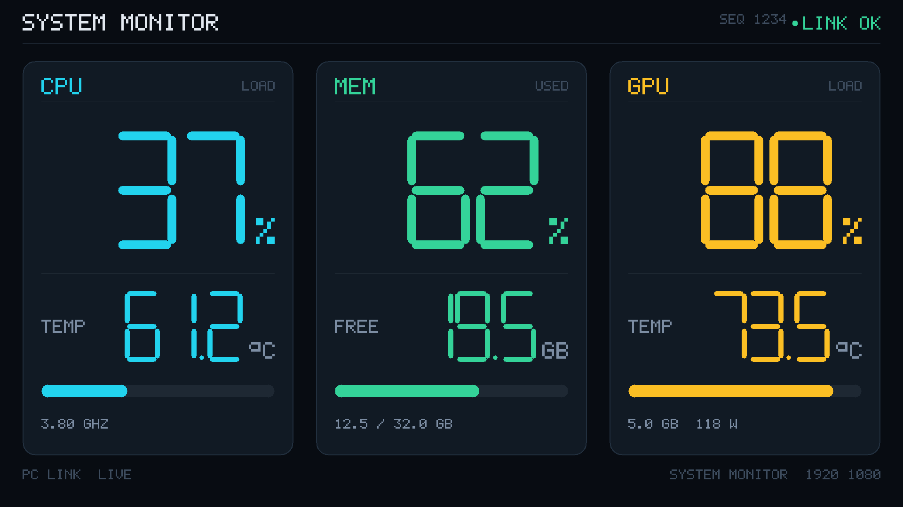

# 监控屏（桌面版）

一个 1920×1080 的全屏看板：CPU / 内存 / GPU 的占用率和温度。
浏览器窗口拖到小屏幕上按 `F` 全屏就行，**不需要动固件、不需要装任何库**。



## 启动：双击 `监控屏.lnk`（不弹黑窗口）

> 刚 clone 下来先跑一次 **`setup.bat`**：它会找到本机 Python 并生成三个快捷方式
> （`.lnk` 指向本机的 `pythonw.exe`，不能跨机器共用，所以没放进仓库）。

双击 **`监控屏.lnk`** 就行，它会把一整套都拉起来：

1. **CPU 温度服务** —— 没在跑就拉起 `lhm_supervisor.py`（管理员权限，弹一次 UAC）。
   守护进程会清掉残留的 LHM、用 `SW_HIDE` 启动一个新的、并把它的窗口按下去，
   所以**全程看不到 LHM 的窗口**（任务栏、托盘都没有）。
2. **数据服务** —— 后台常驻，日志写 `server.log`
3. **浏览器窗口** —— 等第一帧数据出来才打开，不会先闪 NO SIGNAL

停止时（`停止监控屏.lnk`）画面服务**和温度服务一起关**：守护进程收到 `lhm.stop`
旗标后杀掉 LHM 再退出，不需要再点一次 UAC。

```
监控屏.lnk        →  pythonw launch.py          启动全部 + 开浏览器
停止监控屏.lnk     →  pythonw launch.py --stop   关闭画面服务 + 温度服务
温度服务 LHM.lnk   →  单独重启温度服务（一般用不到）
start.bat         →  排错用：会弹一个黑窗口，里面能看到完整报错
```

启动器的判断逻辑写在 `launch.log`，守护进程的写在 `lhm_supervisor.log`。

参数（手工命令行时可用）：

| 参数 | 作用 |
|---|---|
| `--no-lhm` | 不自动启动 LibreHardwareMonitor |
| `--lhm-only` | 只重启温度服务（守护进程），不动画面服务 |
| `--keep-lhm` | 配合 `--stop`：只关画面服务，留着温度服务 |
| `--demo` | 假数据（纯看 UI） |
| `--no-browser` | 只起服务，不开浏览器 |
| `--stop` | 关掉画面服务 + 温度服务 |

> 完全不想看到 UAC：用「任务计划程序」把
> `C:\Tools\LibreHardwareMonitor\LibreHardwareMonitor.exe` 设成「登录时」+
> 「使用最高权限运行」。这样开机它就在了，`launch.py` 检测到 8085 已打开会直接跳过，
> 一次弹窗都不会有。

然后：**把浏览器窗口拖到小屏幕 → 按 `F`（或 `F11`）全屏 → `Esc` 退出**。
鼠标 3 秒不动光标自动隐藏。

只想看 UI、不采数据：

```bat
python server.py --demo
```

## 文件

| 文件 | 作用 |
|---|---|
| `监控屏.lnk` | ★ 双击启动：温度服务 + 数据服务 + 浏览器，一条龙 |
| `停止监控屏.lnk` | 停止数据服务 |
| `温度服务 LHM.lnk` | 单独启动温度服务（launch 一般会自动拉起，这个是备用手动入口） |
| `launch.py` | 启动器：拉温度守护进程、判断服务是否已在跑、等数据就绪再开浏览器、失败弹框 |
| `lhm_supervisor.py` | **温度守护进程**（管理员）：隐藏启动 LHM、清残留、收到旗标就杀掉 LHM |
| `index.html` | 页面外壳：canvas + 轮询 `/api/stats`，几十行胶水代码 |
| `render.js` | **渲染核心**（唯一一份绘制实现），浏览器和 Node 里都能跑 |
| `font.js` | 5×7 点阵字库，由 `tools/gen_font.py` 生成 |
| `collect.py` | 采集：有 psutil 用 psutil，没有就走 ctypes 调 Win32 API |
| `server.py` | HTTP 服务：`/` 给页面，`/api/stats` 给 JSON |
| `start.bat` | 排错用：会弹控制台，能看到报错 |

## 数据来源

| 指标 | 来源 | 要配吗 |
|---|---|---|
| CPU 占用率 | `psutil`；没有就用 `GetSystemTimes()` | 不用 |
| 内存占用 / 总量 | `psutil`；没有就用 `GlobalMemoryStatusEx()` | 不用 |
| CPU 频率 | `psutil`；没有就读注册表 `~MHz`（**基频**，不是实时睿频） | 不用 |
| GPU 占用 / 温度 / 显存 / 功耗 | `nvidia-smi` | 不用（NVIDIA 驱动自带） |
| CPU 温度 | LibreHardwareMonitor | **要** |

CPU 温度：装 [LibreHardwareMonitor](https://github.com/LibreHardwareMonitor/LibreHardwareMonitor)，
管理员运行 → `Options` → 勾 `Remote Web Server` → 端口 `8085` → `Run`。
不开也能用，CPU 温度那块显示 `-- °C`。

装了 `psutil` 会更准（CPU 频率变成实时值）：`python -m pip install psutil`，可选。

## 分辨率

画布固定 **1920×1080**（设计基准），CSS 用 `object-fit: contain` 等比铺满窗口：

- 小屏就是 1920×1080 → 1:1 像素级对应
- 2560×1440 / 1024×600 → 整体等比缩放，版式不变
- 宽高比差太多会留黑边（刻意做的，不拉伸变形）

单独预览某个尺寸：`http://127.0.0.1:8770/?w=1024&h=600`

## 改样式

| 想改什么 | 改哪 |
|---|---|
| 配色 | `render.js` 顶部 `COL`（`#RRGGBB`） |
| 布局 / 字号 | `render.js` 的 `makeLayout()`，里面全是 1920×1080 设计稿坐标 |
| 字形 | `tools/gen_font.py` 里用 ASCII 画，改完跑 `python tools/gen_font.py --preview` |
| 卡片文案 | `render.js` 的 `CARDS`、`secondaryLabel()`、`secondaryUnit()` |

改完刷新浏览器即可，不用重启服务。

## 校验渲染

`render.js` 能在 Node 里跑（`tools/render_check.js` 自带一个最小 canvas 实现），
改完样式直接出图对比，不用开浏览器：

```bash
node tools/render_check.js 1920 1080 tools/js_1920x1080.ppm
node tools/render_check.js 1024 600  tools/js_1024x600.ppm
# 用真实数据出图：
curl -s http://127.0.0.1:8770/api/stats > tools/live.json
node tools/render_check.js 1920 1080 tools/js_live.ppm --jsonfile tools/live.json
```

当前 `render.js` 和 `preview.py` 的输出**整张图逐像素完全一致**（0 差异，含页脚）。

## 故障排查

| 现象 | 原因 |
|---|---|
| 双击 `监控屏.lnk` 提示找不到 Python | 快捷方式指向的 `pythonw.exe` 路径变了；重跑 `start.bat` 看它选中的解释器，或直接改快捷方式目标 |
| 右上角红色 `NO SIGNAL` | 画面服务被关了。看 `server.log`；Windows 里已经没有可见的服务窗口了 |
| 画面全黑 | F12 看控制台，`font.js` / `render.js` 是不是 404 |
| 端口被占用 | `python server.py --port 8781`，再手动开 `http://127.0.0.1:8781/` |
| CPU 温度一直 `--` | LHM 没起来：看 `lhm_supervisor.log`；多半是 UAC 那次点了「否」 |
| GPU 全是 `--` | `nvidia-smi` 不在 PATH，命令行敲 `nvidia-smi` 确认 |
| 字发虚 | Windows 缩放不是 100%；浏览器里按 `Ctrl + 0` 还原 |
| 全屏后上下有黑边 | 屏幕不是 16:9；用 `F11` 而不是浏览器菜单的全屏 |
